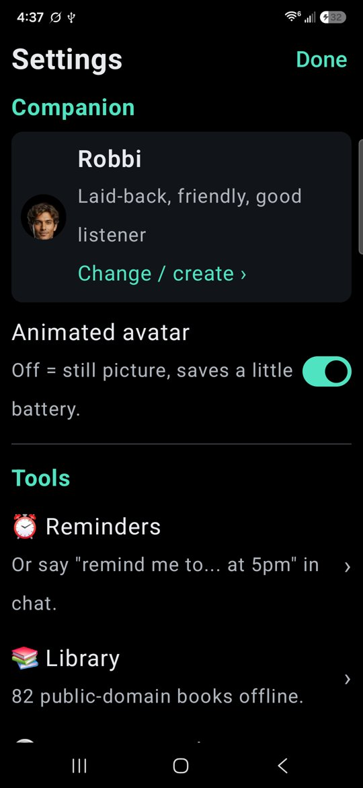

# Aurora Companion for Android (beta)

A fully offline AI companion for Android. The chat AI, speech recognition and voices all run **on your
phone or tablet**: no account, no cloud, no API keys.

This is the Android version of [Aurora Companion (desktop)](https://github.com/robertlionhart-cyber/aurora-companion-beta).

<p>
  
  &nbsp;
  
</p>

## How to install on Android

1. **On your phone or tablet**, open the
   [Releases page](https://github.com/robertlionhart-cyber/aurora-companion-android/releases/latest).
2. Under **Assets**, tap **`AuroraCompanion-0.8.2-beta.apk`** to download it (about 134 MB).
3. When the download finishes, tap it (or open it from your **Downloads**).
4. If Android says your browser isn't allowed to install apps, tap **Settings** and turn on
   **Allow from this source** ("Install unknown apps"), then go back and tap **Install**.
5. If **Google Play Protect** says it doesn't recognise the app, tap **More details > Install anyway**.
   (This happens to any app that isn't from the Play Store.)
6. Open **Aurora**, pick a companion, and download a chat model when asked (Wi-Fi recommended).

**Updating:** download the newer APK and install it over the old one. Your chats and downloads are kept.

### Requirements

- Android 8.0 or newer, **64-bit (arm64)** device
- **4 GB RAM or more recommended** (6 GB+ for the book knowledge feature to be on by default)
- About 1.2 GB free storage for the app + the small chat model (more for the optional extras)
- Tested on a Samsung Galaxy A54 and Xiaomi Pad 5

## Features

- **Private chat** with four built-in companions (Pebbie, Robbi, Leo, Barry) with animated avatars
- **Make your own characters**: create, edit, duplicate, or import character cards
  (SillyTavern / TavernAI V1, V2, V3 JSON and PNG cards, Aurora desktop profiles), and export them
- **Talk out loud**: offline speech recognition (Moonshine) and spoken replies in Robert's voice
  (built in) or 904 optional LibriTTS voices
- **Phone-call mode** on the main screen: hands-free conversation with interruption (barge-in),
  mute and echo cancellation
- **Reminders**: "remind me to call Mum at 5pm" by typing or voice, with alarms and notifications
- **Book library**: 82 public-domain books to read offline, plus an optional "Knowledge from books"
  mode where the companion can quote and cite them
- **Conversation history**: every chat and call is saved on the device to read back, share as text, or delete
- Works with large system font sizes, on phones and tablets

## What the app downloads (only when you tap Download)

The APK already contains the Robert voice, the speech recognition model and the avatars. Everything
else is optional and downloaded inside the app, straight from its original source, only when you choose to:

| Download | Size | Source | License |
|---|---|---|---|
| Llama 3.2 1B Instruct (Q4_K_M), the chat model, recommended | 770 MB | Hugging Face (bartowski/Llama-3.2-1B-Instruct-GGUF) | Meta Llama 3.2 Community License |
| Llama 3.2 3B Instruct (Q4_K_M), only offered on 8 GB+ devices | 1.9 GB | Hugging Face (bartowski/Llama-3.2-3B-Instruct-GGUF) | Meta Llama 3.2 Community License |
| LibriTTS-R voice (904 speakers) | 75 MB | Hugging Face (rhasspy/piper-voices v1.0.0) | CC BY 4.0 |
| Book library (82 public-domain books) | 55 MB + about 37 MB search index built on the device | Project Gutenberg texts via the desktop repo | Public domain |

Downloads are at your own discretion. The author of Aurora Companion does **not** own or make these
third-party models and is not responsible for them; each one is under its own license, which you
agree to by downloading it. Every download is checked against a pinned checksum.

## Privacy

- Fully offline after the downloads: chats, voice and history never leave your device
- No account, no sign-in, no ads, no analytics, no telemetry
- The only network use is the downloads above, when you tap them
- Microphone is used only while you are talking to the companion

## Family-friendly beta

This build is family-friendly. The 18+ mode from the desktop app is **not included** yet: adult
books are left out of the library. Imported character cards written for adult content are kept
family-friendly by a safety rule. AI replies can still be wrong or odd. Please read
[DISCLAIMER.txt](DISCLAIMER.txt).

## Build from source

You need **JDK 17**, the **Android SDK** (platform 36, build-tools 36.0.0, **NDK 29.0.13113456**,
**CMake 3.31.6**) and git.

```powershell
git clone https://github.com/robertlionhart-cyber/aurora-companion-android.git
cd aurora-companion-android
powershell -ExecutionPolicy Bypass -File scripts\fetch_deps.ps1     # macOS/Linux: bash scripts/fetch_deps.sh
# tell Gradle where the SDK is (or set ANDROID_HOME):
echo sdk.dir=C:/path/to/Android/sdk > local.properties
.\gradlew.bat :app:assembleDebug                                    # macOS/Linux: ./gradlew :app:assembleDebug
```

The APK ends up in `app/build/outputs/apk/`. The first build compiles llama.cpp and takes a while.

`fetch_deps` downloads llama.cpp (pinned commit), the sherpa-onnx AAR and the bundled voice/ASR assets
into `third_party/`; see [third_party/README.md](third_party/README.md).

**Signing:** `assembleRelease` uses the key described in a `keystore.properties` file
(`storeFile`, `storePassword`, `keyAlias`, `keyPassword`) found via `aurora.keystoreProps` in
`local.properties`, the `AURORA_KEYSTORE_PROPS` environment variable, or `./keystore.properties`.
Without one it falls back to the debug key. APKs you sign yourself can't install over the official
release (different signature), so uninstall it first.

### Project layout

- `app/`: the Aurora app (Kotlin, Jetpack Compose)
- `lib/`: the llama.cpp JNI bridge (based on llama.cpp's Android example)
- `scripts/`: dependency fetch and build helpers
- `third_party/`: fetched dependencies (not in git)

## Licenses

See [THIRD_PARTY_NOTICES.md](THIRD_PARTY_NOTICES.md). `en_US-robert-medium` is Robert's own voice
model, included for personal use with Aurora Companion only. Do not redistribute it or use it to
impersonate him.
