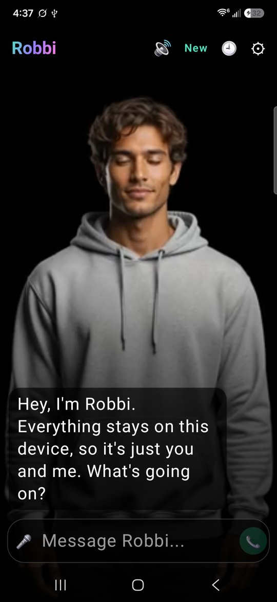

# Aurora Companion for Android (beta) - Family edition

A private AI companion for Android. The chat AI, speech recognition and voices all run **on your
phone or tablet**: no account, no cloud, no API keys. This is the **Family edition**: family-friendly
everywhere, with no 18+ content at all.

This is the Android version of [Aurora Companion (desktop)](https://github.com/robertlionhart-cyber/aurora-companion-beta).

<p>
  
  &nbsp;
  
</p>

## How to install on Android

1. **On your phone or tablet**, open the
   [latest release](https://github.com/robertlionhart-cyber/aurora-companion-android/releases/latest).
2. Under **Assets**, tap **`AuroraCompanion-Family-<version>.apk`** to download it (about 135 MB).
   If the link does nothing inside the X app, open the page in Chrome or Samsung Internet first.
3. When the download finishes, tap it (or open it from your **Downloads**).
4. If Android says your browser isn't allowed to install apps, tap **Settings** and turn on
   **Allow from this source** ("Install unknown apps"), then go back and tap **Install**.
5. If **Google Play Protect** says it doesn't recognise the app, tap **More details > Install anyway**.
   (This happens to any app that isn't from the Play Store.)
6. Open **Aurora**, pick a companion, and download a chat model when asked (Wi-Fi recommended).

**Updating:** from 0.8.6 on, the app updates itself: **Settings > Updates > Check for updates** downloads the
newest release from this page, checks its size, SHA-256 and signature, and hands it to Android's installer.
Your chats, characters and downloads are kept. (Older versions: install the new APK over the old one once.)

### Requirements

- Android 8.0 or newer, **64-bit (arm64)** device
- **4 GB RAM or more recommended** (the "Smart" 3B model wants 6-8 GB)
- About 1.2 GB free storage for the app + the light chat model (more for the optional extras)
- Tested on a Samsung Galaxy A54 and a Xiaomi Pad 5

## Features

- **Five built-in companions**: Aurora, Pebbie, Robbi, Leo (cat) and Barry (dog), with animated avatars that
  react with emotion clips (happy, laughing, surprised, sad, waving, coffee, news, weather...) and doze off when it's quiet
- **Avatar packs** (Settings > Companion > Avatars): small optional downloads that add animations to the built-in
  companions and new family-friendly companions (**Scott** and **Globe**). If a look isn't downloaded yet, the
  animated Globe stands in.
- **Chat modes** from the chip under the companion's name: Best Friend, Supportive, Playful, Mentor / Coach,
  Storyteller and Assistant. Companions talk like a friend, not like "a language model".
- **Online / Offline switch** (quick menu): when Online, the companion can look up the weather, news headlines and
  quick facts. Off by default; see Privacy.
- **Quick menu**: the small person button at the top opens a toolbar with companions, history, new chat,
  voice on/off and Online, so the screen stays clear
- **Make your own characters**: create, edit, duplicate, or import character cards
  (SillyTavern / TavernAI V1, V2, V3 JSON and PNG cards, Aurora desktop profiles), and export them
- **Talk out loud**: offline speech recognition (Moonshine) and spoken replies in Robert's voice
  (built in) or 904 optional LibriTTS voices
- **Phone-call mode** on the main screen: hands-free conversation with interruption (barge-in),
  mute and echo cancellation
- **Reminders**: "remind me to call Mum at 5pm" by typing or voice, with alarms and notifications
- **Book library**: 82 public-domain books to read offline, plus an optional "Knowledge from books"
  mode where the companion can quote and cite them
- **Conversation history**: every chat and call is saved on the device to read back, **continue**, share as text, or delete
- **Running memory**: after each chat or call the companion writes a few short notes about you (name, likes, plans)
  and remembers them in new chats. View, edit, add or wipe them on the Memory screen, or turn memory off
- **In-app updates** (Settings > Updates), with an optional quiet daily check
- Works with large system font sizes, on phones and tablets

## What the app downloads (only when you tap Download)

The APK already contains the Robert voice, the speech recognition model and the core avatars. Everything
else is optional and downloaded inside the app, straight from its original source, only when you choose to:

| Download | Size | Source | License |
|---|---|---|---|
| **Family · Light**: Llama 3.2 1B Instruct (Q4_K_M), recommended | 808 MB | Hugging Face (bartowski/Llama-3.2-1B-Instruct-GGUF) | Meta Llama 3.2 Community License |
| **Family · Smart**: Llama 3.2 3B Instruct (Q4_K_M), only for powerful devices | 2.0 GB | Hugging Face (bartowski/Llama-3.2-3B-Instruct-GGUF) | Meta Llama 3.2 Community License |
| Avatar packs (Aurora, extra animations, Scott, Globe) | 0.1-1 MB each | this repo's [`avatars-v1` release](https://github.com/robertlionhart-cyber/aurora-companion-android/releases/tag/avatars-v1) | see Avatars below |
| LibriTTS-R voice (904 speakers) | 75 MB | Hugging Face (rhasspy/piper-voices v1.0.0) | CC BY 4.0 |
| Book library (82 public-domain books) | 55 MB + about 37 MB search index built on the device | Project Gutenberg texts via the desktop repo | Public domain |

Downloads are at your own discretion. The author of Aurora Companion does **not** own or make these
third-party models and is not responsible for them; each one is under its own license, which you
agree to by downloading it. Every download is checked against a pinned checksum. Built with Llama.

## Privacy

- Chats, voice, history and memory notes never leave your device
- No account, no sign-in, no ads, no analytics, no telemetry
- Network use: the downloads above when you tap them; the update check (GitHub) if you leave it on; and, **only while
  Online is switched on**, the words of a weather, news or look-up question (or your city) are sent to Open-Meteo,
  BBC News / Google News RSS, Wikipedia or DuckDuckGo. Your chats are never sent.
- Microphone is used only while you are talking to the companion

## Family-friendly

Every companion, mode and avatar in this edition is family-friendly. Imported character cards written for adult
content are kept family-friendly by a safety rule. AI replies can still be wrong or odd. Please read
[DISCLAIMER.txt](DISCLAIMER.txt).

## Build from source

You need **JDK 17**, the **Android SDK** (platform 36, build-tools 36.0.0, **NDK 29.0.13113456**,
**CMake 3.31.6**) and git.

```powershell
git clone https://github.com/robertlionhart-cyber/aurora-companion-android.git
cd aurora-companion-android
powershell -ExecutionPolicy Bypass -File scripts\fetch_deps.ps1     # macOS/Linux: bash scripts/fetch_deps.sh
# tell Gradle where the SDK is (or set ANDROID_HOME):
echo sdk.dir=C:/path/to/Android/sdk > local.properties
.\gradlew.bat :app:assembleFamilyDebug                              # macOS/Linux: ./gradlew :app:assembleFamilyDebug
```

The APK ends up in `app/build/outputs/apk/`. The first build compiles llama.cpp and takes a while.

`fetch_deps` downloads llama.cpp (pinned commit), the sherpa-onnx AAR and the bundled voice/ASR assets
into `third_party/`; see [third_party/README.md](third_party/README.md).

**Signing:** release builds use the key described in a `keystore.properties` file
(`storeFile`, `storePassword`, `keyAlias`, `keyPassword`) found via `aurora.keystoreProps` in
`local.properties`, the `AURORA_KEYSTORE_PROPS` environment variable, or `./keystore.properties`.
Without one they fall back to the debug key. APKs you sign yourself can't install over the official
release (different signature), so uninstall it first.

### Project layout

- `app/`: the Aurora app (Kotlin, Jetpack Compose); `app/src/family` holds the Family edition settings
- `lib/`: the llama.cpp JNI bridge (based on llama.cpp's Android example)
- `scripts/`: dependency fetch and build helpers
- `third_party/`: fetched dependencies (not in git)

## Avatars

The avatar clips are the author's own creations (no real people), re-encoded small for phones. Avatar packs are
zip files with a manifest; the app only accepts a pack whose SHA-256 matches the list pinned in the app.

## Licenses

See [THIRD_PARTY_NOTICES.md](THIRD_PARTY_NOTICES.md). `en_US-robert-medium` is Robert's own voice
model, included for personal use with Aurora Companion only. Do not redistribute it or use it to
impersonate him.
